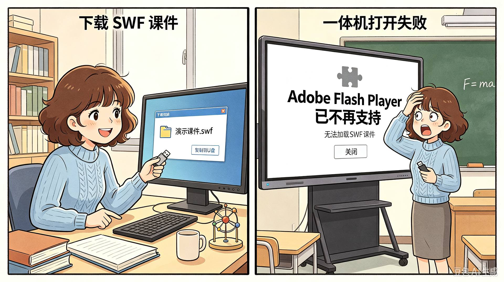

# 初高中物理演示课件新生计划

一个**开放收录**初高中物理 HTML5 演示课件的公共仓库。

谁做的课件就署谁的名，项目只负责收录、审校、分类和分发。不是统一引擎，不是官方生产，也不是只由维护者自己写。无论你是物理老师、学生、前端开发者，还是用 AI 辅助生成动画的爱好者，都欢迎来玩。

---

## 为什么做这个

### 1. 老课件打不开

当年课堂上双击就能播放的 Flash 物理动画，现在经常打不开。

- Adobe 已于 2020 年底停止支持 Flash Player，浏览器不再原生播放 `.swf`。
- 很多老课件在新电脑上一双击没反应，或者被浏览器拦截、提示“插件不受支持”。
- 教师只能靠本地播放器“抢救式”打开，换一台机器可能又失败。
- 学生和年轻教师甚至不知道这些文件原本该怎么播放。



### 2. 存量资源庞大但分散

网上流传着成百上千个 Flash 物理动画，质量参差不齐，缺少统一维护，很多链接和资源包已经失效。

### 3. 老课件难以修改

教师想改一个参数、换一个单位、调整一个标注，往往做不到；源码和素材也基本不可得。

### 4. HTML5 资源存在，但不够开放

不少 HTML5 虚拟实验和交互课件集中在商业平台或付费资源站，零散、封闭、难以二次开发；散落在个人博客、网盘、CodePen 里的作品又缺少索引，教师根本找不到。


### 5. 想贡献的人没有入口

很多老师、学生、开发者其实愿意做一两个 HTML5 动画，但做完之后没有一个公共的地方可以放，也没有统一的收录标准和分类索引，作品很快就沉没了。

### 6. 教学正确性缺少社区审校

动画做得炫不等于物理讲得对，光路、电路、受力方向一旦画错，反而误导学生。

---

## 项目想做什么

> **做一座“开源课件仓库”：谁都可以把自己独立做的 HTML5 物理动画提交进来，经过简单审校后收录、分类、索引，供所有教师免费使用。**

具体来说：

- **每个课件彼此独立**：不要求复用同一个引擎、同一套技术栈、同一种代码风格。
- **贡献者保留自己的作品**：你做的动画仍然是你做的，项目只负责收录、分类和分发。
- **AI 辅助生成完全欢迎**：用 AI 写出来的、自己改过的、手工写的，只要满足收录标准，一视同仁。
- **维护者主要做“编辑”而不是“开发”**：定标准、做索引、跑审校、发版本，而不是替所有人写动画。
- **目标是形成一个持续生长的公共资源池**，而不是一个封闭的产品。
- **初中、高中都收录**：两边分类目录已经建好，操作流程完全一样，只是放的目录不同。

---

## 收录什么

按学段和主题分类，收录**单个 HTML 文件即可运行的交互演示课件**。

### 初中（`junior_high/`）

- **力学**：杠杆平衡、滑轮组、二力平衡、惯性、浮力与沉浮、液体压强、连通器
- **电学与电磁学**：串并联电路、滑动变阻器、电流表/电压表、欧姆定律、家庭电路、奥斯特实验
- **热学**：分子热运动、物态变化、内燃机
- **光学**：凸透镜成像、光的反射折射、平面镜成像、近视/远视矫正
- **声学**：声音的产生与传播、音调响度、回声

### 高中（`senior_high/`）

- **力学**：平抛运动、圆周运动、牛顿运动定律、动量守恒、机械能守恒
- **电学**：电场线、电势、电容器、带电粒子在电场中的运动
- **电磁学**：磁场、安培力、洛伦兹力、电磁感应、楞次定律、交变电流
- **热学**：气体状态方程、热力学第一定律、分子动理论
- **光学**：光的干涉、衍射、偏振、折射定律
- **振动与波**：简谐运动、机械波、波的叠加与干涉
- **近代物理**：光电效应、原子结构、半衰期、核反应

不要求覆盖全部知识点，**一个课件讲清一个点就够**。如果找不到合适的主题，可以自己新建一个主题目录，在 PR 描述里说明一下即可。

---

## 收录标准（提交前请自检）

每个课件需要满足：

1. **至少有一个 `.html` 文件**，能正常打开；如果依赖图片/音频，放在同一目录或 `assets/` 下并说明。
2. **无需登录、注册、付费、订阅**：打开即用，核心功能免费，不把功能藏在付费墙后面。
3. **有交互**：至少支持拖动、调参、开关、暂停/复位中的一种，而不是纯视频播放。
4. **物理正确**：公式、方向、单位、标注经得起检查；有简化假设请在页面或 `README.md` 里注明。
5. **有中文 README.md**：写明对应知识点、适用年级、操作方法、简化假设、版权说明。高中课件请写清必修/选择性必修/选修。
6. **有 LICENSE**：贡献者需声明使用 MIT、CC BY-SA 4.0 或类似开源许可；不接受来源不明、反编译自 Flash 的素材。
7. **不侵权**：不使用未经授权的教材插图、商业课件素材、他人美术资源。
8. **AI 生成已核对**：如果用了 AI 辅助，公式、方向、单位、文案已由提交者本人逐项核对。

> 本项目**不禁止**使用外部 CDN、在线 API、在线字体、在线库。只要课件能正常打开、核心功能免费、不需要登录或付费，就可以收录。
> 
> 审校不追求“完美”，但**不误导学生**、**能正常打开**、**没有登录/付费门槛**是三条底线。

---

## 仓库怎么组织

项目采用**扁平收录 + 索引驱动**的方式，不强制统一代码结构：

```text
physics-demo-xinsheng-plan/
├─ junior_high/                     # 初中
│  ├─ mechanics/                    # 力学
│  │  ├─ lever_balance/
│  │  │  └─ lever_balance_demo(Lili_Zhao)/
│  │  │     ├─ lever_balance_demo.html
│  │  │     ├─ README.md
│  │  │     ├─ LICENSE
│  │  │     └─ assets/
│  │  └─ ...
│  ├─ electricity/                  # 电学与电磁学
│  ├─ thermal/                      # 热学
│  ├─ optics/                       # 光学
│  └─ sound/                        # 声学
├─ senior_high/                     # 高中
│  ├─ mechanics/                    # 力学
│  ├─ electricity/                  # 电学
│  ├─ electromagnetism/             # 电磁学
│  ├─ thermal/                      # 热学
│  ├─ optics/                       # 光学
│  ├─ vibration_wave/               # 振动与波
│  └─ modern_physics/               # 近代物理
├─ index/
│  ├─ catalog.json                  # 全库索引：标题、知识点、作者、许可、路径
│  └─ catalog.md                    # 自动生成的人类可读目录
├─ docs/
│  ├─ submission-guide.md           # 提交指南（详细版）
│  ├─ review-checklist.md           # 审校清单
│  └─ images/
├─ scripts/
│  └─ build-catalog.ts              # 扫描课件目录生成 catalog
├─ CONTRIBUTING.md                  # 贡献指南（必读）
├─ LICENSE
└─ README.md
```

每个课件目录的命名格式是：

```text
<课件名>(<作者>)
```

示例：

```text
junior_high/optics/convex_lens/convex_lens_show(San_Zhang)
senior_high/electromagnetism/electromagnetic_induction/induction_lab(Lili_Zhao)
senior_high/nuclear_physics/half_life_demo(San_Zhang)   # 自己新建主题的例子
```

- **课件名**：建议英文小写 + 下划线，也可以用中文或拼音。
- **作者**：英文名，放在英文括号 `()` 里。中文名按“名在前、姓在后”的拼音，如 `San_Zhang`；也可以用自己的英文名，如 `Eric_Liu`；版权属于组织就写组织英文名，如 `Miaoxin_Technology`。
- **目录名和文件名里不留空格**，空格统一用下划线 `_` 替换，这是为了兼容 GitHub、命令行和 URL。
- **其他地方正常使用空格**：PR 标题、commit message、README 正文、LICENSE、Issue 描述，都正常写空格，不用刻意换成下划线。

每个课件目录至少放：

```text
<课件名>(<作者>)/
├─ <你的课件>.html           # 名字自己定，不必须叫 index.html
├─ README.md                 # 中文说明，写介绍和版权说明
├─ LICENSE                   # 本课件的许可证
└─ assets/                   # 可选，图片/音频等资源
```

> 不需要放预览图，不用 `preview.png`。如果想展示未来改进计划，可以额外放一个 `PLAN.md`。

### 索引是自动更新的

`index/catalog.json` 和 `index/catalog.md` 由 GitHub Actions 自动生成，**不要手改**：

- **任何一次推送到 `main`**（新增或删除课件、改文档、改脚本都算）都会触发工作流 `catalog.yml`：重新扫描两个学段目录，内容有变化就把结果提交回 `main`（提交信息形如 `chore(catalog): 自动更新索引`），内容没变则什么都不提交。不需要任何人手动运行脚本。
- 因此 PR 里**不必**附带 `index/` 的改动；就算带了，合并后也会被机器人覆盖成正确结果。
- 想立刻重建一次，到仓库 Actions 页面选「自动更新课件索引」，点 **Run workflow** 即可。

本地预览生成结果时（可选，不参与流程）：

```bash
node scripts/build-catalog.ts          # 生成到 index/
node scripts/build-catalog.ts --check  # 只校验是否最新，不写文件
node scripts/build-catalog.ts --strict # 有警告即以非零码退出
```

脚本从目录名 `<课件名>(<作者>)` 取标题和作者，从课件 `README.md` 的「对应知识点 / 适用年级 / 作者」条目和同目录 `LICENSE` 取其余字段；README 顶部也可以写 YAML 头覆盖这些字段，键名见 `scripts/build-catalog.ts` 文件开头的注释。目录名不合规、缺 README / LICENSE、缺知识点时会给出警告，不会中断生成。

---

## 怎么用（老师 / 使用者）

- **在线浏览**：GitHub Pages 会自动部署 `index/catalog.md` 的可点击版本，按学段和知识点浏览。
- **离线使用**：GitHub Releases 会按学期/分类打包 ZIP，下载后解压，双击 HTML 即可打开。
- **单个课件**：进入对应目录，下载里面的 HTML 和 `assets/` 文件夹，放到同一位置，双击 HTML 即可。

> 使用前建议看一眼课件目录里的 `README.md`，里面有对应知识点、操作方法、简化假设和许可说明。

---

## 怎么贡献（开发者 / 老师）

欢迎物理老师、前端开发者、教研员和学生一起参与。完整流程和手把手教程见 **[贡献指南](CONTRIBUTING.md)**，这里只列个概要：

1. **Fork** 本仓库到你的账号下。
2. 在 `junior_high/<主题>/` 或 `senior_high/<主题>/` 下创建课件目录 `<课件名>(<作者>)/`。
3. 放入 HTML、`README.md`、`LICENSE`，可选 `assets/`。
4. 对照收录标准自检。
5. 提交 PR，标题格式：`新增：<知识点> — <课件名> (<作者>)`。
6. 等待审校，按意见修改。
7. 合并后自动进入索引，在线演示页下一次部署后可见。

**不熟悉 GitHub 也完全没关系**，[贡献指南](CONTRIBUTING.md) 第 6 节从注册账号开始，用最通俗的话一步一步教你，不需要写代码，也不需要懂 Git 命令，只用浏览器就能完成。

### 关于审校时间

审校者都是志愿者，平时要上课、备课、改作业，时间比较零散。你的 PR 提交后，**不一定能在 48 小时内得到回复**，等几天甚至一两周是正常的。超过 14 天没有任何回复，可以礼貌地 ping 一次 `@maintainers`。请多一点耐心，不用反复催。

---

## 许可

- **每个课件版权归原作者**，贡献者需在课件目录的 `README.md` 和 `LICENSE` 中声明许可。
- 推荐使用 **MIT** 或 **CC BY-SA 4.0**，便于学校免费使用和二次修改。
- **不接受**反编译自 Flash 课件的素材、来源不明的图片音频、未经授权的教材插图。
- 项目自身的索引、脚本、文档使用 **MIT License**，详见根目录 [LICENSE](LICENSE)。

---

## 路线图

- [x] 建立初中、高中分类目录结构
- [x] 编写贡献指南、收录标准、审校清单
- [x] 写好 `build-catalog` 脚本，自动生成索引
- [ ] 🎯长期目标：覆盖初高中物理主要知识点，形成可持续生长的公共课件库

---

## 有问题？

- 不确定分类、命名、许可：开 Issue 问，标签 `question`
- 找不到合适的主题：先看看已有主题，确实没有就自己新建一个，PR 里说明一下
- 想找一件事做：看 `good first issue` 和 `scene-request`
- 不熟悉 Git / PR：直接开 Issue 说“我有一个课件但不会提交”，维护者会协助你
- 想看别人怎么提交的：翻一翻已经合并的 PR，照着做一遍就懂了
- GitHub 打不开：可以参考 [visiting-Github-without-VPN-successfully](https://github.com/miaoxintechnology/visiting-Github-without-VPN-successfully)

---

## 一句话总结

**初中高中都欢迎，谁都可以做，谁都可以交，没有合适的主题就自己开一个。让经典的交互动画，以开源、轻量、可维护的 HTML5 形式继续活下去。**

Miaoxin Technology

2026年10月24日
